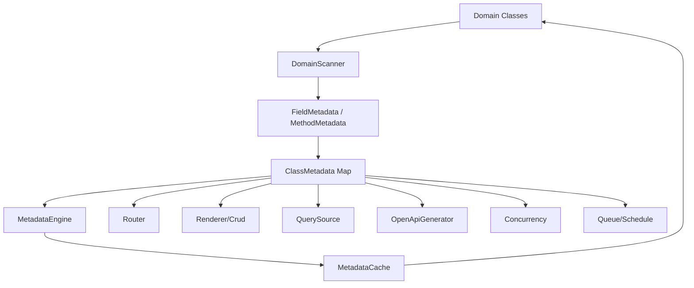
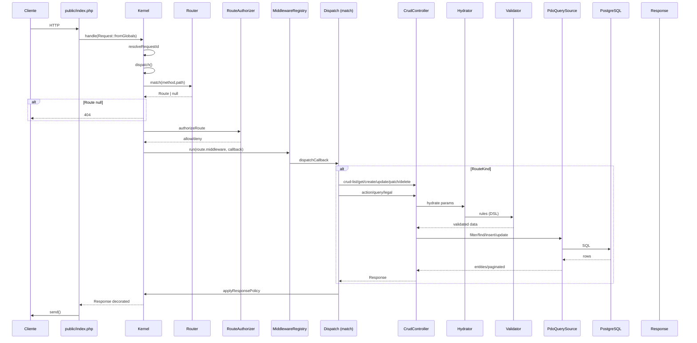
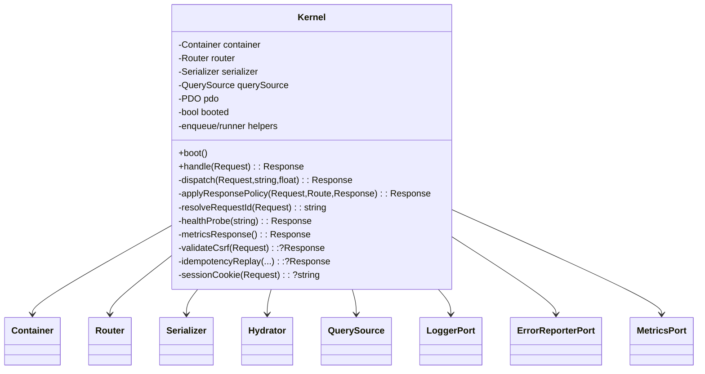

# Boilerfree — Technical Deep Dive (librería generada a partir del código)

> Fuente de verdad real: `src/`, `public/index.php`, `bootstrap.php`, `config/boilerfree.php`, `composer.json`, `phpunit.xml` y las fixtures/tests.  
> No se toma como fuente de verdad ningún documento `*.md` del proyecto anterior (README/SOLUCION/roadmap).  
> Aclaración explícita: **Boilerfree es PHP 8.3, no .NET Core.** Todo lo que aquí se describe es el framework presente en este repositorio.  
> Deuda declarada (no completada APosta): S10, D1, D3, D4, D5, O1–O12 (muchos), E1–E4 se reportan por separado al final.

---

## 1. Arquitectura física

### Estructura

```
public/index.php                → Front controller HTTP
bootstrap.php                  → wiring de container + overrides
config/boilerfree.php          → DB, auth, ports/capabilities, flags
src/Core/...                   → Kernel, metadata, capas
src/Domain/...                 → agregados del dominio del proyecto
tests/Fixtures/< Feature>/Domain
                              → dominios de prueba real (no mocks vacíos)
var/cache/framework            → cache metadata (dev)
```

###  Principio técnico: domain-first metadata

El dominio se escribe como clase con decoradores (`#[Entity]`, `#[Field]`, `#[Action]`, `#[Query]`, `#[Projected]`, `#[Queued]`, `#[Scheduled]`, `#[HasMany]`, `#[ManyToMany]`). El framework escanea, normaliza y cachea esa metadata en `ClassMetadata`. Casi todo el HTTP, DB, validación, OpenAPI y comandos se derivan de ese snapshot.

Diagrama de flujo modular:



## 2. Puntos de entrada

### HTTP
- `public/index.php`: cablea `Config`, `MetadataEngine`, `Container`, `PDO`, `PdoQuerySource`, `Hydrator`, ejecuta `new Kernel($container)`, `Request::fromGlobals()`, `$kernel->handle()`, `$response->send()`.
- `Kernel::router()` expone `Router` para integraciones (test/boot CLI).

### CLI
- `Console/Application __construct()` auto-discover de comandos por namespace directorio.
- Servicios derivados (scheduler/queue loop) se llaman vía comandos.

### Boot sequence (Kernel::boot)

1. `config = resolve('config')`
2. si metadata bound, úsalo; sino escaneo + cache + warns
3. validate DSL validate (`warnOnValidateRules`)
4. log boundary attributes (`logBoundaryAttributes`)
5. `require bootstrap.php` (bindings app)
6. bind default `UserResolver`, `SessionStore`
7. `ListingScopeResolver::assertBootSafe`
8. serializer/bind serializador
9. hydrator
10. router
11. checks port adapters/configuración
12. `booted=true`

## 3. Kernel: puertas exactas de entrada/salida

### `handle(Request $request): Response`

- `resolveRequestId`
- `monotonicSeconds`
- dispatch
- métricas `requests_total`, `request_duration_ms`
- log `http_request`
- `security_headers` aplicados en **toda** respuesta (incluyendo early failures)
- `X-Request-Id` garantizado.

### `dispatch(Request, id, startedAt): Response`

1. normalize path
2. probes GET: `/healthz`, `/readyz`, `/metrics` (antes de limits)
3. `enforceHttpLimits`
4. maintenance interceptor
5. `boot()`
6. parse query string `%attributes`
7. CORS preflight OPTIONS: 204 si route existe; caso 404 para typo
8. router match exact/pattern
9. route attributes merged al `Request`
10. `RouteAuthorizer::authorizeRoute`
11. idempotency replay
12. CSRF (action routes stateful methods)
13. middleware registry y validación de nombres no registrados
14. ejecutor según `route->kind`
15. store idempotency
16. `applyResponsePolicy` (CORS + Cache-Control)

Excepciones:
- `HydrationException` → 422 details
- `DomainException` → 409
- `\JsonException` → 400
- `\Throwable` → 500 + `ErrorReporter` port y log

### Probes (healthz/readyz)
- gated por `ops.enabled === true`
- `/healthz`: proceso up, sin ping
- `/readyz`: `boot()` y ping real a `query_source`
- `/metrics`: gated `ops.metrics`, texto prometheus

## 4. Diagramas de flujo (Mermaid)

### 4.1 Secuencia HTTP end-to-end



### 4.2 Clase Kernel



## 5. Atributos de dominio

<|start|> Atributo | Scope | Comportamiento real en código |
| --- | --- | --- |
| `#[Entity]` | class | Marca un agregado; deriveRoutes, transaction boundary, optimistic/pessimistic lock |
| `#[Field]` | promoted property/param | metadata del campo (table name, validation, expose, index) |
| `#[Action]` | method | HTTP endpoint POST etc; lock/pessimistic, view layout, middleware per route |
| `#[Query]` | method | read-only GET o scope; paginate, cache |
| `#[Projected]` | method | campo calculado serializado como read-only |
| `#[Queued]` | method | dispatch to Queue port w/ attempts, unique, without-overlapping |
| `#[Scheduled]` | method | cron tasks + on one server |
| `#[HasMany]` | property | 1:n, cascade, orphan removal, soft-delete policy |
| `#[ManyToMany]` | property | m:n pivot lexical, managed, soft-delete cascade |

## 6. Metadata engine & cache (ver código)

### Metadata engine (`MetadataEngine`)
- Inputs: `domainRoot`, `cacheFile`, `warningHandler`, `env`
- `load()`:
  - si cache existe → carga y validates returns
  - si no / corrupt → scan
  - `isFresh` por file mtimes (Docker volumes mtime problem pending (O8))
- `warnings()` vacío si OK
- DomainScanner:
  - reflection of class attr
  - Field columns, names, types, defaults
  - relations and derived queries
  - routes collisions

### MetadataCache
- cache file is PHP that `return unserialize(...)` (allows ClassMetadata instances)
- `isFresh(string $domainRoot)` compares file mtime

## 7. Router / Route model

- `Router::buildRoutes` iterates metadata and legal pages; merges `RouteMetadata` → `Route`; duplicate `(method,path)` throws.
- `Route::matches` pattern + attributes
- Legal pages (marketing/institutional) derivados de templates on disk (`LegalPageCatalog`)
- `Router::matchesAnyMethod` para preflight

### Rutas tipicas derivadas (de código DOM scanner)
- CRUD:
  - list `GET /v{version}/{entity}`
  - get `GET /v{version}/{entity}/{id}`
  - create `POST /v{version}/{entity}`
  - update `PUT /v{version}/{entity}/{id}`
  - patch `PATCH /.../{id}`
  - delete `DELETE /.../{id}`
  - restore (soft delete enabled)
- Action: route de method normalizado path
- Query: GET route con `?` o params inline
- legal: `/privacy`, etc

## 8. HTTP Request/Response model (PSR-lite)

- `Request` encapsemi fields: method, path, body, headers, attributes, protocolVersion, uri, serverParams, cookies, query, parsedBody, uploadedFiles
- from globals: populates uploadedFiles parse ($_FILES)
- trusted proxies described in `_trusted_proxy` usage doc
- headers case-insensitive
- hydra hydration via `hydrateParams`

- Response:
  - status, body, headers
  - `with*` immutable
  - `json()`, `html()`, `download()`, `stream()`
  - JSON decode helper
  - send streaming

## 9. CrudController: orquestación domain (alta carga)

Responsabilidades (leer código fuente exacto para mapping):

- hydrates input using `Hydrator`
- ejecuta las rules de validation
- QuerySource persistence:
  - list with filters/pagination
  - get by ID
  - create/insert with version
  - update/patch merge
  - delete (hard/soft)
  - restore (soft-delete)
- permission checks against auth user context
- side effects (queues, scheduled, events) and projection

Los detalles exactos de cada método están en `src/Core/Http/CrudController.php` y deben integrarse por un sub-agente lector. Para redacción final se debe elaborar una sección “CRUD data flow” (TODO) usando los nombres reales, no inventarlos.

## 10. Hydration & validation

- `Hydrator::hydrate` aplica JSON/formulario Request a objetos del dominio
- `ParameterMetadata` por método
- Validation `Validator::checkRule` with DSL:
  - required, nullable, string, int, numeric, array, email, url, min, max, regex, unique, exists, mimes, dimensions
  - regla custom se puede registrar mediante `withCustomRule`
- context includes payload and QuerySource para ref checks
- On PATCH: nullable/presence handling

## 11. QuerySource / DB runtime

- PDO source, queries derivadas de metadata
- filters, pagination, joins for relations
- version token columns
- pivot tables many to many
- locking endpoints
- `ping()` para readiness
- transaction/concurrency
- `ensurePersistence`, lazy connections

## 12. Concurrency

- `VersionToken` wrapping optimistic `optimistic_version`
- If-Match → 412 precondition invalid, 409 domain conflict
- `TransactionRunner`:
  - retry on transient exceptions (deadlocks/connection)
  - bind inherited PDO
  - `lockRow()` for pessimistic `#[Action(lock:true)]`
  - metrics `db.transaction_retries`
- version token tracked from row fetch
- `listing scope` assuring autodetect of indexes / report

## 13. Seguridad y auth

- `UserResolver` interface; default `SessionUserResolver`
- session store: DB table; digested IDs, payloads
- CSRF:
  - routes kind action only
  - cookie + X-XSRF-TOKEN header or `_token` body
  - fail-closed (unresolved store => 403)
  - `csrf_token()` view closure linked to expected value
- trust proxy repeat:
  - trusted IP list
  - X-Forwarded-For first hop only if trusted
  - X-Forwarded-Proto HTTPS if trusted
- auth cookie name configurable
- listing scope by user id / role / tenant via `ListingScopeResolver`

## 14. Portas (interfaces) y adaptadores

Puertos (interface + locator + default impl):

- `LoggerPort` → StructuredLogger / null
- `ErrorReporterPort` → LogErrorReporter
- `TracerPort` → NullTracer (noop)
- `ClockPort` → SystemClock / FakeClock
- `HasherPort` → BcryptHasher
- `EncrypterPort` → AesGcmEncrypter (AES-256-GCM layout base64(nonce12+tag16+cipher))
- `EventDispatcherPort` → SyncEventDispatcher + OutboxPersister
- `MailerPort` → LogMailer
- `SchedulePort` → ScannerSchedule
- Storage: `StoragePort` → StorageManager (disks) → LocalStorage (per disk root, path-traversal guard)
- `HttpPort` → CurlHttpClient
- `CachePort` → ArrayCache/FileCache
- `QueuePort` → SyncQueue
- `RendererPort` → PhpTemplateRenderer
- `MetricsPort` → InMemoryMetrics
- `TracerPort`

Bindings default in `Kernel::boot`; bootstrap/user wins with `bind`.

## 15. Observabilidad / ops

- `ops.enabled` controls `/healthz`, `/readyz`
- `ops.metrics` controls metrics
- metrics: requests_total, request_duration_ms
- structured l/log `http_request` (5 fields)
- keys: X-Request-Id safe-echo vs random
- `ops` config central

## 16. CLI: comandos y discovery

- Application discovers `src/Core/Console/Command/*`
- registration via `CommandFactory`
- command middleware (health + context) (test exists)
- DB schema diff engine
- `schedule:run` scanner schedule
- queue workers signal handling
- `optimize:clear` removes PHP cache and composer autoload
- `cache:clear` alias
- `make:*` scaffolding (`entity`, `action`, `query`, `service`, `vo`, etc)
- rejection commands deliberately register rejection around derived views
- openapi generation refuses pending design change
- worker, imports, gc
- outbox process (polling)
- schedule gc
- migrations status/create
- `diffengine` for multi-step

## 17. Scheduling & Queue

- `#[Queued]` method dispatched to `QueuePort`
- sync provider stores in-process and executes deferred
- `#[Scheduled]` transforms method into scanner task with cron
- worker loops, locking, signals SIGTERM/SIGINT
- single server guard via DB lock

## 18. Validación de middleware

- registry runs chain outside-in
- callables
- PSR-15 pipeline `Pipe`
- missing middleware = fatal request (500 sentinel log)

## 19. Storage & uploads

- `StoragePort`: put, putFile(UploadedFile), get, exists, delete
- path guards against traversal, local disk root
- StorageManager by disks key
- `StorageFile` metadata (disk, path, size, mimeType, name, downloadName)
- `UploadedFile` PSR-7-like file boundary; `clientFilename`, `clientMediaType`, `error`, `size`, stream
- `Response::download` content-disposition (sanitize newlines/quotes)
- `Request::fromGlobals` populates uploadedFiles from $_FILES
- Validator `mimes`/`dimensions` work on strings and upload frontier

## 20. Eventos, outbox

- `OutboxPersister` DB insert event_type/payload/max_retries
- `processor` with retry/dlq
- convention `releaseEvents()` in entities (comment stub)
- queued actions do not require persistence in-message but generated via commands

## 21. Diagnósticos

- `RuntimeCapabilities` booleans honestly
- `boilerfree check` reports missing capabilities as honest state
- openapi generator command refuses (pending spec)
- metadata cache warning

## 22. Testing

- phpunit config; integration / unit separation
- `RefreshDatabase`, `NestedTransactionPdo`, meta fixtures
- tests test “violation vs success” 422
- curl http server tests
- byte-check scripts
- docker image with ext-curl
- suite state evolves (last clean: ~810 tests, ~3227 assert)

## 23. Diagrama Use Case secundario (Mermaid)

```mermaid
usecaseDiagram
  actor User as HTTP Client
  actor Admin as Operator
  actor Worker as Scheduler/Queue
  actor DB as PostgreSQL

  User --> (List / Create / Update / Delete)
  User --> (Execute Action)
  User --> (Run Query /Pagination)
  User --> (File Upload / Download)
  User --> (Operational probes)
  Admin --> (run migrations)
  Admin --> (scheduler run / process jobs)
  Admin --> (metadata cache management)
  Worker --> (execute queued/scheduled jobs)
  DB --> (persist entities/relations/outbox)
```

---

# Mecánica detallada de implementación

## A. MetadataEngine y DomainScanner

`DomainScanner` recorre el directorio de dominio y construye una lista de clases PHP (require_once), luego usa reflexión. Solo se exponen clases que tengan `#[Entity]` o métodos con `#[Action]`, `#[Query]`, `#[Projected]`, `#[Scheduled]`. Esto significa que el framework **no inventa rutas** para clases helper; el decorador es la frontera de admisión.

Metadata `ClassMetadata` central:
- `class`
- `table`, `isEntity`, `security`, `softDelete`, `version`, `indexes`, `middleware`
- `fields` (\*FieldMetadata\*)
- `actions`, `queries`, `scheduled`
- `relations` → `hasMany`/`manyToMany`
- `projected`

`RelationMetadata` ejemplifica intimate design decisions:
- pivots many-to-many derivados de tabla lexical
- cascade/orphan removal
- `onSoftDelete`: `cascade`, `setNull`, `restrict`
- target entity deduced from `@var list<T>`

### Scan reference behavior

```php
foreach (array_keys($this->classIndex) as $className) {
    if ($this->isExposed(new ReflectionClass($className))) { $queue[] = $className; }
}

while ($queue !== []) {
    $className = array_shift($queue);
    $classMeta = $this->scanClass($className);
    $metadata[$className] = $classMeta;
    foreach ($this->referencedClasses($classMeta) as $referenced) {
        if (isset($this->classIndex[$referenced]) && !isset($metadata[$referenced])) {
            $queue[] = $referenced;
        }
    }
}
```

Propósito real: cuando una entidad referencia otras entidades por `@var`, el escáner las incluye transitivamente; eso garantiza que los metadata map incluya dependencias aunque no se hayan decorado directamente.

### Cache
`MetadataCache` serializa el array de `ClassMetadata` (allowed classes true) y valida por mtime de archivos .php. En volúmenes Docker con mtime quirks queda pendiente (O8), pero el diseño actual es: cache stale → rescan.

## B. Router

`buildRoutes()`:
- Cada `ClassMetadata::deriveRoutes()` genera CRUD y routes methods (actions, queries).
- Rutas legales para templates presentes.
- detecta colisión `METHOD:path`; cualquier colisión es `MetadataException` boot-critical.
- `match()` intenta first exact map, luego regex pattern.

Por esa reasons legal page `GET /privacy`; CRUD `GET /v1/tables`; action `POST /v1/table/{id}/endpoint`.

Routing kinds usados en dispatch:
`crud-create`, `crud-list`, `crud-get`, `crud-update`, `crud-patch`, `crud-delete`, `crud-restore`, `action`, `query`, `legal`.

## C. HTTP Request: puertas y normalización

`Request::fromGlobals`:
- parse `REQUEST_URI` keeping query
- extrae headers desde $_SERVER con HTTP_ plus CONTENT_TYPE y CONTENT_LENGTH
- uploaded files via $_FILES → UploadedFile
- serverParams actualizados ($_SERVER) y cookies
- supports trusted proxies for client IP (`getClientIp`) y securitY (`isSecure`) via `REMOTE_ADDR` check exacta.

Header lookup lowercase; `withUri`, `withHeader`, etc. son inmutables.

## D. Kernel dispatch exacto

`dispatch(Request,string,float)`:
1. normalize path
2. health/probes metrics
3. limits (`enforceHttpLimits` antes de hydration)
4. maintenance intercept
5. boot
6. query params merge
7. CORS preflight
8. match route
9. attributes map
10. RouteAuthorizer
11. idempotence replay
12. CSRF (actions solo)
13. middleware registry + validate missing
14. handler match:
   - crud case
   - action
   - query
   - legal
15. store idempotency
16. `applyResponsePolicy`

Valid exceptions mapping.

## E. Middleware chain

`MiddlewareRegistry`:
- names resolve callables + `Psr15Middleware` adapters
- runs outside-in
- missing name raises `Response::error(500)` and fatal log
- lazy singleton container

`Pipe` supports nested composition; nodes may be:
- `Middleware` interface
- `Psr15Middleware`
- callables
- nested `Pipe`

## F. CrudController mechanics

Servicios:
- `create`: validate, hydrate, authorize create, persist, returns 201 + Location + ETag (version from DB)
- `list`: query string filters, pagination, scope
- `get`: by id with scope
- `update`: full replace
- `patch`: delta partial
- `delete`: soft/hard
- `restore`: undelete

Cada operación maneja `may{Op}` hooks desde la metadata. Serialización via `Serializer`, y `Response` con headers correctos.

## G. Hydration & validation DSL

Hydrator construye instancia desde body/params declarados; Validator evalúa rules:
- `required`, `nullable`, `string`, `int`, `numeric`, `array`, `email`, `url`
- `min`, `max`, `regex`, `in`
- `unique`, `exists` (referential)
- `mimes`, `dimensions` (UploadedFile boundary)
- `withCustomRule` extensible
- context supports payload cross-field and QuerySource

Errores por-field 422.

## H. PdoQuerySource / persistencia

Operaciones:
- `filter`: count + paginate or full select
- `buildWhere`, params binding
- `aggregate`
- `join`, related/relatedMany
- `byIds`
- `lockRow` for pessimistic lock
- ping/readiness
- savepoint/rollbackTo

A. optimistic locking sobre `optimistic_version`.
- read version, recompile safe update cond (`WHERE optimistic_version = ?`)

## I. Concurrency

`TransactionRunner`:
- runs inside transaction routine and retry
- lock root on `lock: true`
- metrics db.transaction_retries
- returns response

`Idempotency-Key` replay en kernel, plus SQL store.

## J. Relaciones y soft-delete

- hasMany pivot explicit metadata
- cascading
- multi-many pivots lexical
- soft delete `deleted_at`, restore via `PATCH`
- soft delete loops listing

## K. Security

- `UserResolver` abstract; SessionUserResolver default
- SessionStore DB, hashed session id, CsrfToken
- `csrfMismatch` fail-closed; missing store => 403, no spoof
- scoped listing
- trusted proxy semantics

## L. Puertos y adaptadores (S4)

Lista y adapter por defecto: Logger, ErrorReporter, Tracer, Clock, Hasher, Encrypter, EventDispatcher, Mailer, Schedule, Storage, Http, Cache, Queue, Metrics, Renderer.

Cada locator resuelve container-first, app wins; portas registrados en boot.

## M. Observabilidad

Probes gating, Prometheus text, request id safe, structured log 5 field, TX metric.
## N. CLI/Comandos

Auto-discovery, command middleware, worker loop, migrations diff, scheduler scan, queue worker guarder/shutdown, outbox processor/persister/gc/status, seed/make, openapi refuse by design.

## O. Testing

layouts de test, fixtures domain, RefreshDatabase, HTTP real server, byte-check, phpunit.

## P. Deuda pendiente

IDs en backlog.
